# OpenMinis × DSH agent 内核 — 架构与前后差别

本文回答三件事：**原来长什么样**、**现在长什么样**、**每一处差异的根因是什么**。

所有"原来"的引用都指向 `zhaoxiufei/OpenMinis` main（iOS 15 基线，本地 `upstream/main`）；
"现在"指向本文档所在仓库的 HEAD。

---

## 0. 一页对照

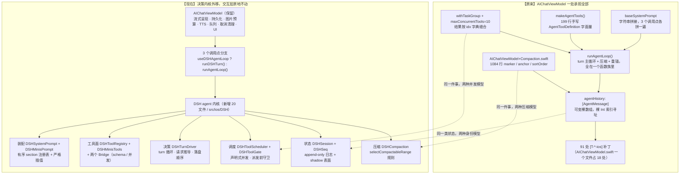

**替换的五个"决策段"**：系统提示词装配、工具注册与 schema、工具调度、会话身份、压缩。
**保留的一切**：流式渲染、持久化、图片预算、TTS、队列、取消清理、全部 UI，以及**每个工具的实际实现**（handler 原地复用）。

**没有接上的**：**group fallback**。原循环在内部捕获可回退的 provider 错误、切到组内下一个成员、重建 prompt 并插入"⚠️ 已切换到 X"。DSH 驱动只跟构造时那一个 provider 说话——所以主成员限流/故障时，DSH 回合直接失败报错，而不是静默换备。这一条**在文档里被错写成"仍留在 ViewModel"过**，是审计抓出来的；本机只有一个 provider，装不了第二个来实测。详见 §8。

---

## 1. 分层结构

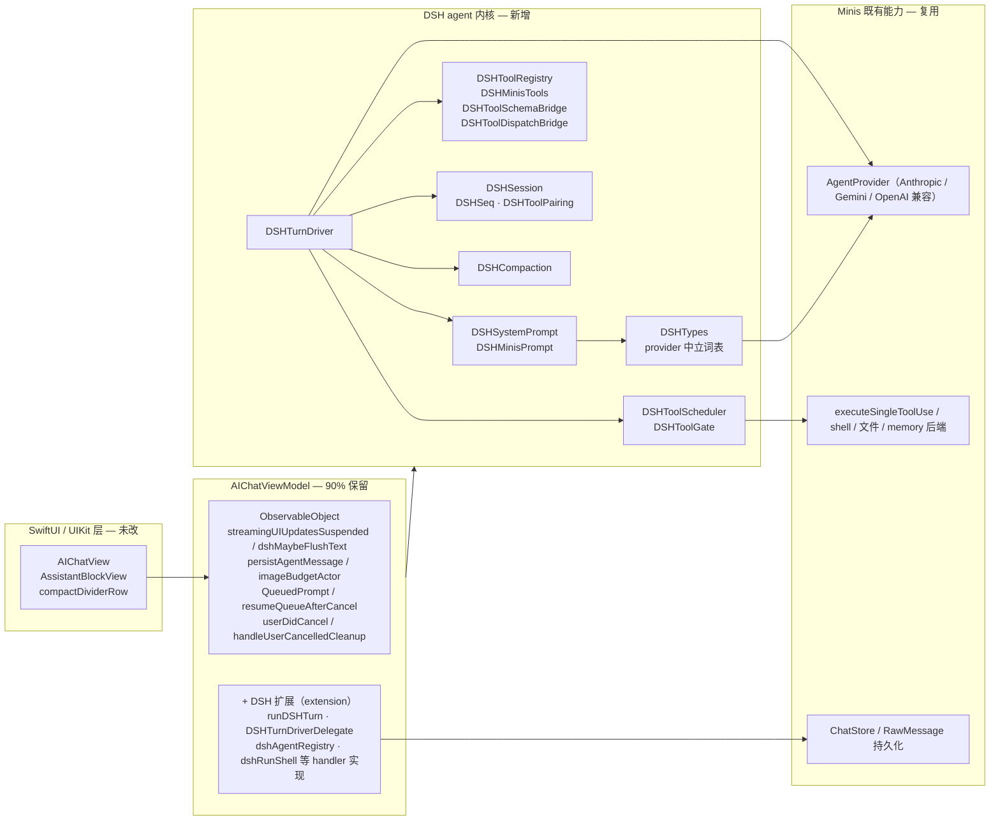

关键边界：**DSH 内核不认识 `AIChatViewModel`，也不认识 `ChatMessage`。**
它只认识 `DSHMessage` / `DSHContentBlock` / `DSHToolExecutionResult`，进出都靠两个 Bridge 翻译。
这条边界就是"能同时移植到 iOS 15 与 iOS 26 两条源码线"的原因——内核与 Minis 的耦合只集中在 4 个 Bridge 文件里。

---

## 2. 一轮 turn 的时序

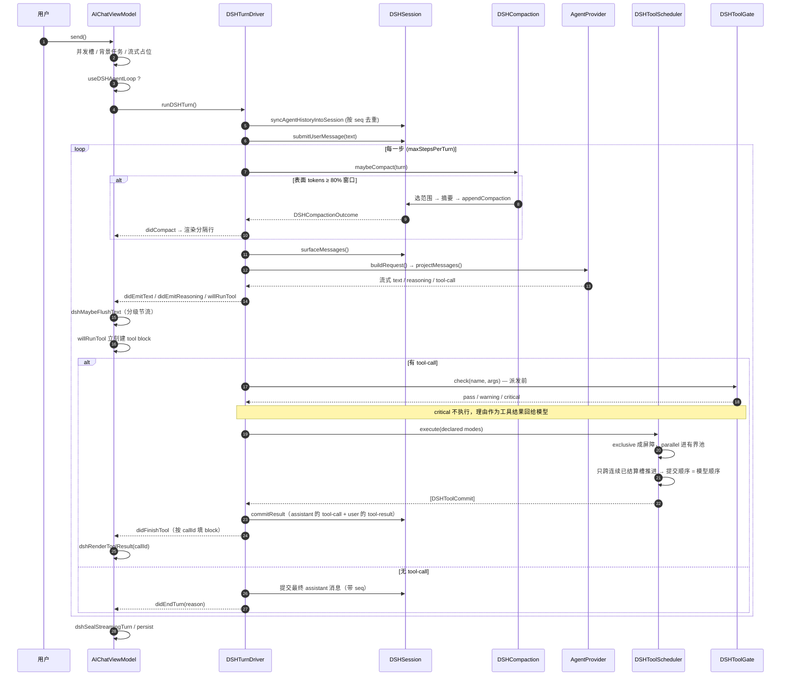

### 原时序的差别

| 环节 | 原来 | 现在 |
|---|---|---|
| 每轮起点 | `try Task.checkCancellation()` 后**重新按稳定 id 重锚 `msgIdx`**（`[T-ios-inloop-compact-freeze]`） | 不需要。seq 是不变量，不存在"重锚"这个动作 |
| 上下文检查 | 只在 `send()` 入口的 `checkContextBeforeSend()` + 循环内每轮重新评估 `ContextPolicy`（`.needsCompact` / `.exhausted`），压缩计数上限 `maxInLoopCompactions = 3` | `DSHTurnDriver.maybeCompact()` 一步，阈值 = 服务模型真实窗口的 80% |
| 工具结果回填 | `withTaskGroup` + `outcomesByIndex: [Int: ToolExecOutcome]`，之后 `guard let outcome = outcomesByIndex[idx] else { continue }` | `DSHSlotStore` + `commitReady()` 只跨连续槽推进，无索引可丢 |
| 工具 UI block | 结果挂在 `pendingSnapshots` / `toolStatusStrings`，靠二次遍历 `messages[msgIdx].blocks` 匹配 `toolUseId` | `willRunTool` 就建 block，`didFinishTool` 按 `callId` 填，别的路径抢不走 |
| 提示词 | 每个调用点 `baseSystemPrompt` 各拼一遍 + `capabilityPromptFragment` + `agentBehaviorPromptFragment` | `dshSystemPrompt` 有序 section 装配，运行时片段走 `context()` |

---

## 3. 会话身份：裸 Int 索引 → DSHSeq + shadow

这是整次移植里**唯一一个"删掉一整类 bug"**的改动，也是理解那 91 处补丁的钥匙。

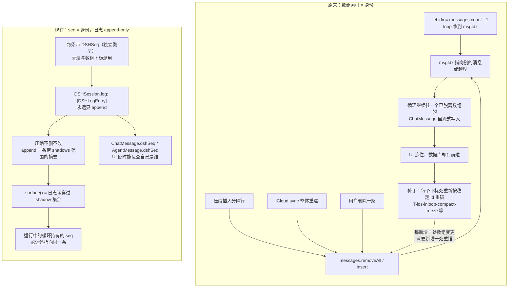

### 为什么会有那 91 处补丁

`AIChatViewModel` 用**裸 `Int` 下标**寻址可变数组里的对话条目，而所有东西都能在 loop 运行期间改变这个数组：
压缩插入分隔行、iCloud 同步整体 `reloadMessagesFromDB`、用户删除、状态行 `removeAll`。

每一次变更都会让 loop 手里那个 `Int` 失效。失效的表现**不是崩溃而是静默**：loop 还在往一个已经不在数组里的 `ChatMessage` 写内容，屏幕不动，但数据库在前进。于是每个能被观察到的下标使用点都长出了一处"按稳定 id 重锚"的补丁。每一处单看都正确；合起来的意思是——**任何一处新增的数组变更，都要配套新增 N 处重锚**。

`DSHSession` 消掉的是这个类，而不是这些实例：

| 手段 | 效果 |
|---|---|
| 日志只 append，条目永不移动/替换/删除 | 没有"失效"这个状态 |
| `DSHSeq` 是独立类型（不是 `Int` 别名） | 编译期阻止把 seq 当下标用 |
| 压缩用追加的摘要**遮蔽**一段 seq 范围 | 运行中的 loop 持有的 seq 仍然有效 |
| `surface()` 是"日志穿过当前 shadow 集合"的派生视图 | 表面会变，日志不变 |
| `DSHToolPairing.cutBalances` / `nearestBalancedBefore` | 切点保证 tool call 与 result 不分离 |

最后一条对应原来的 `[T-ios-compact-orphan-toolcall]`：原来用**发送前扫描孤儿 tool part 再修补**（`AIChatViewModel+Persistence.swift:1506` 起）来兜底，现在是**切点根本不允许切在那里**。

---

## 4. 工具调度：cap + 索引缝合 → 声明式并发 + 连续提交

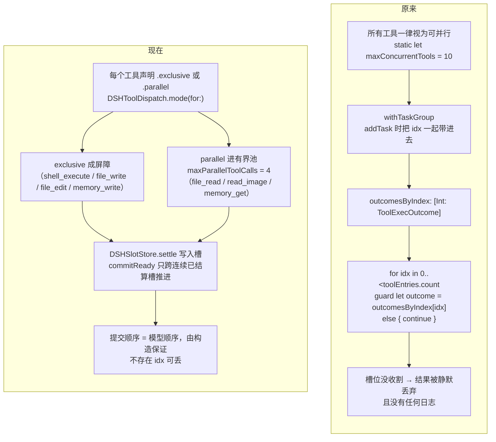

三点实质差别：

1. **并发是数据，不是假设。** 原来"所有工具都可并行 + 一个 in-flight 上限"，等于假设工具之间没有共享状态。实际上 `shell_execute` / `file_write` / `file_edit` 都在动同一个沙箱。现在它们标 `.exclusive`，重叠执行从"靠运气"变成"不可能"。未知工具**默认 exclusive**——想并行必须显式声明，而不是默认继承。
2. **顺序由构造保证，而不是靠事后缝合。** 原来结果按 `idx` 存在字典里再按 `0..<count` 遍历回填，缺一个就 `continue` 掉。现在提交器只跨**连续已结算**的槽前进，模型顺序天然成立，且没有中间容器可以丢东西。
3. **守门在派发之前。** `DSHToolGate.check()` 在工具真正执行前跑：重复的无进展调用**不会执行**，理由是作为工具结果回给模型（`warning` / `critical` 两级 + 稳定 hash 归一化参数），而不是执行完再抱怨。

---

## 5. 压缩：marker / anchor / sortOrder → selectCompactableRange

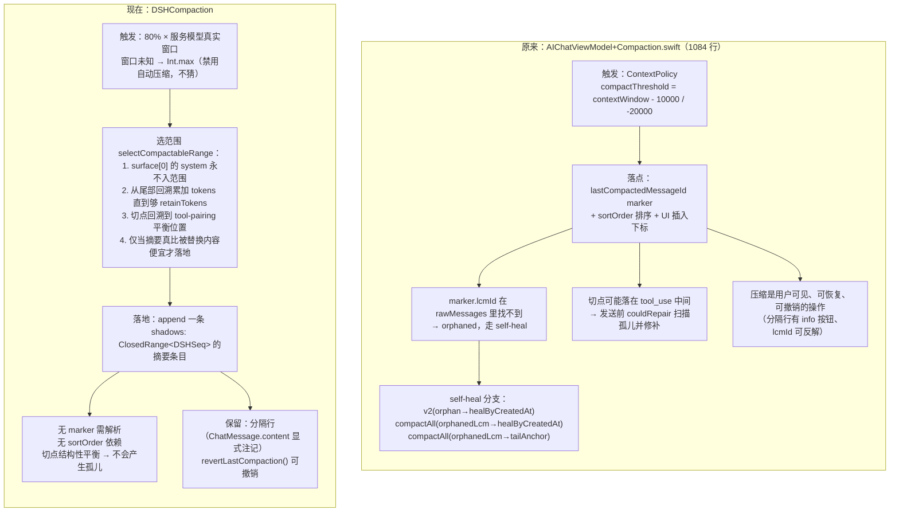

### 阈值语义的差别（重要）

| | 原来 | 现在 |
|---|---|---|
| 触发点 | `窗口 - 10000`（大窗口）/ `窗口 - 20000` | `窗口 × 80%`（262144 → **209715**） |
| 窗口未知时 | 按 `ContextPolicy` 的默认分支 | **`Int.max` = 不自动压缩** |
| 循环内次数上限 | `maxInLoopCompactions = 3`，超过则"exhausted"停机 | 无人工上限；由"摘要必须真的更便宜"+"切点必须平衡"自然收敛 |
| 保留尾部 | 无显式预算，靠 marker 位置 | `retainTokens = 20000` |
| 落地条件 | 压缩成功即落地 | 摘要更便宜才落地，否则**拒绝** |

"窗口未知就不压缩"是一个刻意的选择：**把用户当前的请求压缩掉，比跑长一点更糟。**

### 实测数据（真机 iPhone 13 / iOS 15.3.1）

| | 压缩前 | 压缩后 |
|---|---|---|
| surface 条目 | 18 | **9** |
| 估算 tokens | 2026 | **1330** |
| 缩减 | — | **34%** |

同一轮里的 `shell_execute` 照常完成，压缩后模型仍能从摘要正确作答。算法另用 Python 等价实现（`_testdata/compaction_probe.py`）跑过合成表面：

| 场景 | 结果 |
|---|---|
| 20 × 20k 字符长工具输出 | 缩小 94%，切点平衡 |
| 图片块 | 缩小 73%，切点平衡 |
| 刚过阈值 | 缩小 45%，切点平衡 |
| retain 预算 > 整个表面 | 正确拒绝 |
| 会话太小 / 无 system 头 | 正确拒绝 |

---

## 5.5 压缩的持久化：让压缩活过重启

**这是整次移植里最"必须想清楚"的一处。** DSH 的会话是内存对象，压缩（shadow）也只存在于内存里。如果不管它，重启后会发生什么：

1. App 从数据库重建对话 → 完整的一整条，压缩成果没了；
2. 驱动再次从完整历史起跑，表面立刻又超过 80% 窗口；
3. 于是**每一轮都在压缩**，而且如果单次压缩后仍然装不下（保留尾 + 摘要 > 窗口），请求直接报错。

### 不要另造一套：Minis 已经有对的东西

Minis 自己的压缩持久化模型和 DSH 的形状**完全一致**：

| | DSH | Minis |
|---|---|---|
| 边界 | `shadows: ClosedRange<DSHSeq>` | `CompactMarker.lastCompactedMessageId`（v2：**到此为止（含）都是被压缩的**） |
| 摘要 | shadow 范围内的一条 summary entry | `CompactMarker.summary` |
| 模型可见 | `surface()` 穿过 shadow 集合 | `effectiveAgentHistory()` 把摘要**注入到 anchor 之后第一条 user 消息** |

所以正确做法不是新写一套落库格式，而是**把 DSH 的压缩翻译成 Minis 的 marker**：

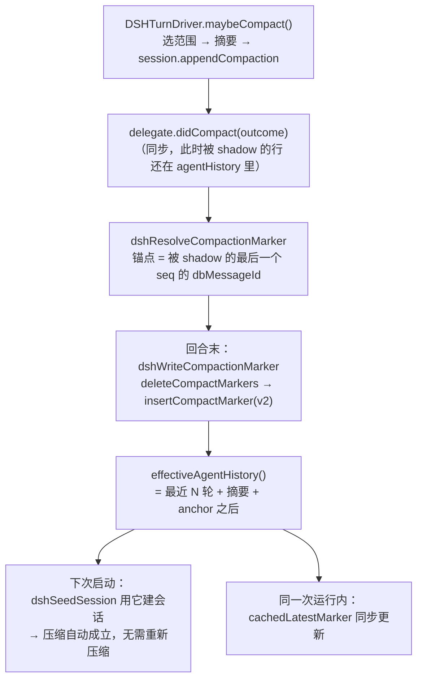

三个关键点：

**① 锚点是数据库 id，而 reconcile 会重建 `agentHistory`。** 所以标记在 `didCompact` 里**当场解析**（那时被 shadow 的行还在数组里），写库推到回合末（store 是 actor，不能同步 await）。同时 reconcile 改成**按 seq 把 dbMessageId 带过去**——否则同一次运行内的第二次压缩根本找不到锚点。

**② 一次只留一个 marker。** DSH 的摘要是**累进**的：上一次的 summary 本身就在下一次 shadow 的范围内，会被渲染进摘要模型的输入。所以最新的摘要天然覆盖"从头到锚点"，正好就是 v2 marker 的语义。写新的之前先 `deleteCompactMarkers`，而不是堆叠。

**③ 摘要本身不再作为消息落库。** 它由 marker 承载；再存一行会让重启后**摘要和被它顶掉的原消息同时出现**。

### 顺带修掉的会话生命周期 bug

`dshSession` 原来是"每个 ViewModel 建一次、永不重建"——切换会话会**继承上一个会话的历史**。现在按 `sessionId` 记名（`dshSessionOwner`），换会话即重建。

### 播种时的两个 bug（探针诊断行抓出来的）

第一版播种写完，压缩确实写进了库、也确实活过了重启、分隔行也渲染了——**但重启后驱动看到的还是整条对话**，于是每次启动都把同一段对话重新压一遍。这类问题从库、从截图、从崩溃日志都看不出来，所以探针行里加了一行种子诊断：

```
DSH surface: 66 entries, ~2566 tokens (compact at 2000)
  | seed: sess=… marker v2 anchor=… anchorResolves=false history=33(withDbId=33) effective=33
```

一行就说明了全部。两个 bug：

**① 播种没有把 seq 写回 `agentHistory`。** 紧接着的同步按 seq 判断"这行在不在会话里"，于是把每一行都当成缺失、**又追加了一遍**——整个会话翻倍（33 行 → 66 条）。这就是诊断行里 `66 ≈ 33 × 2` 的来源。修法：播种时逐行回写 seq。

**② 播种后没有让 `agentHistory` 与之一致。** 播种取自 `effectiveAgentHistory()`（它应用了压缩标记），所以它**排除掉的行就是被压缩的前缀**；这些行留在 `agentHistory` 里，同一个同步会把它们追加回来，把刚做完的压缩抹掉。修法：播种后直接 `agentHistory = seeded`——既防复活，又保住 `dbMessageId`（下一次压缩的锚点靠它解析）。

修完之后同一行变成：

```
seed: sess=1A2B3C4D marker v2 anchor=5D6E7F80 anchorResolves=true history=11(withDbId=11) effective=11
```

`anchorResolves=true`、surface 11 条（不再翻倍）、压缩在重启后**确实被应用**。

教训写在这里：**"压缩写进库了"和"压缩生效了"是两件事**，中间那段路只能靠一条能读到的诊断行来证明。

---

## 5.6 重跑：retry / resume / 消息级重跑

原实现里 `retry()`、`resume()`、`retryFromMessage()`、`retryFromToolBlock()` 直接调 `runAgentLoop(resumingAt:committedBlocks:)`。后果有两层：

- 点"重试/继续"时**跑的是另一个循环**，却拿着 DSH 的提示词和 DSH 的名册（`runAgentLoopCore` 里按开关取 `dshSystemPrompt` / `dshAgentTools()`），界面没有任何提示；
- 那一轮产出的行没有 `dshSeq`，下一次 reconcile 会**整批丢掉**——屏幕上有，模型看不到。

现在**6 个入口全部**按 `useDSHAgentLoop` 分派（send / retry / resume / resumeUnansweredUserTurn / launchRerunAgentLoop / drainQueuedPrompts）。

重跑需要 append-only 的反面，所以 `DSHSession` 加了显式截断：

```swift
@discardableResult
public func truncate(after seq: DSHSeq?) -> Int
```

- 丢掉 `seq` 之后的所有条目，以及**摘要或 shadow 范围被一起丢掉的压缩记录**；
- **不回退 `nextSeq`**：seq 在会话生命周期内永不重用，避免"旧 seq 被当成新条目"；
- 只在**没有循环在跑**时调用——此时没人持有 seq。这正是 append-only 要消除的失效模式，所以它必须是显式的、有名字的、带注释的例外，而不是随手 `removeAll`。

`runDSHRedrive(afterSeq:)` 在此之上再丢掉 `messages` 里对应的行（按 seq，以及末尾无 seq 的 assistant 行），否则重试后屏幕上会出现两份回答。

| 入口 | 截断点 |
|---|---|
| `retry()` / `resume()` | 最后一条 user 条目（把这次失败尝试追加的一切都退掉） |
| `retryFromMessage` / `retryFromToolBlock` | 那条消息的 `dshSeq`；会话不认识该行时退回"最后一条 user" |
| `send` / `drainQueued` | 不截断（用户消息已追加在末尾） |

### 还有一处：发送前的上下文闸门

`send()` 在派发前会查一次上下文，它对 `.needsCompact` 的处置是原版 `compactAndSend()`——**这是原版内核还能接管 DSH 对话的最后一处**。它会在 DSH 驱动的表面上再写一个 marker、再做一次摘要，而驱动下一瞬间要重写这个表面。

DSH 回合本来就在构造请求前按 80% 窗口自查自压，所以闸门在这里无事可做：现在它只记日志并继续发送。`.exhausted` 的提示保留——那是"整个请求都装不下"，与由谁压缩无关，驱动无法自愈，用户需要知道，这正是你担心的"重启后直接报错"的场景。


---

## 5.7 怎么验证压缩（探针是构建输入）

压缩的正式阈值是"服务模型窗口的 80%"——这台机器上是 209715 token。要在真机上触发它，得先灌满 20 万 token；而 `input_text` 有 7000～8000 字符上限，靠手打灌不进去。

所以有个编译期探针：把压力阈值降到 2000 token、保留尾部降到 400，几次普通工具回合就能触发。

**它现在是工作流输入，不是源码里的 `false`**：

```yaml
workflow_dispatch:
  inputs:
    compaction_probe:
      description: 'TEST BUILD: lower the compaction thresholds'
      type: boolean
      default: false
```

```bash
gh workflow run build-ipa.yml -f compaction_probe=true -f build_ios26=false -f create_release=false
```

- 探针是**编译期条件**（`DSH_COMPACTION_PROBE` + `SWIFT_ACTIVE_COMPILATION_CONDITIONS`），因为运行期开关在这个 app 里活不下来——它启动时注册自己的 defaults 字典并整份重写 plist；
- 探针构建的产物叫 `…-probe-unsigned.ipa`，打 warning 注解，并且 **publish job 直接跳过**，所以它不可能污染 Release。

之前它是源码里写死的 `false`，意味着"要验证就得改代码、发一版、再记得改回来"——这种验证最后不会被执行。

---

## 5.8 验证时抓出的三个"只在真机才看得见"的问题

**① 文本块每次 flush 都被覆盖成最后一片。** `setStreamingTextBlockContent` 是**替换**语义，原 loop 传的是整轮累积文本；DSH 路径传的是"本次待刷的增量"，于是每刷一次，块内容就被换成自己的最后一片。表现：回答以 ` ``` ` 结尾时，屏幕上只剩一个空的 `text` 块——**数据库里答案是对的**，只有 UI 是空的。这正是"只看截图会误判、只看数据库也会误判"的那种 bug。

**② 取消后 UI 给的是「重试」而不是「继续」。** 验证脚本一开始找 `继续`/`Interrupted`，什么都没找到就报"没有恢复控件"。控件名要以 app 实际画的为准，不能按猜的来。

**③ 会话对象每个 ViewModel 只建一次。** 切换会话会继承上一个会话的历史。现在按 `sessionId` 记名重建。

---

## 6. 系统提示词：字符串拼接 → 有序 section 注册表

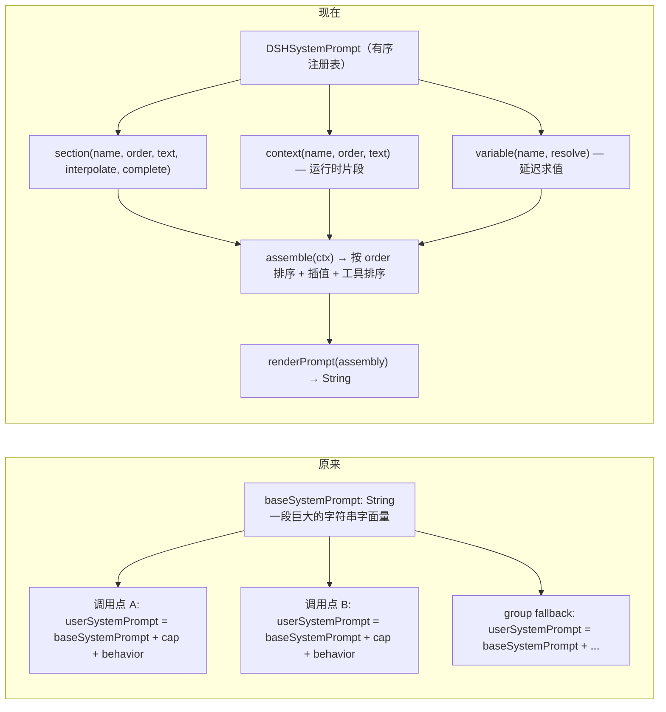

- `{{variable}}` 是**严格**插值：`DSHSystemPrompt.interpolate` 按 UTF-16 code unit 扫描（`nextCloseBrace`），不认识的变量不会被静默吃掉。
- 三段内容分包：**基础内核段** `dshSystemPrompt`、**Minis 专属段** `DSHMinisPrompt.registerBase(into:)`（返回反注册闭包）、**运行时上下文** `DSHMinisPrompt.runtimeContextSection`（模型名 / provider / cwd / 工具名 / isHelper）。
- 反注册闭包让提示词是**资源而非全局状态**：注册即得 undo，作用域结束即干净。

---

## 7. 工具注册：手写字面量 → 注册表 + 类型化 schema

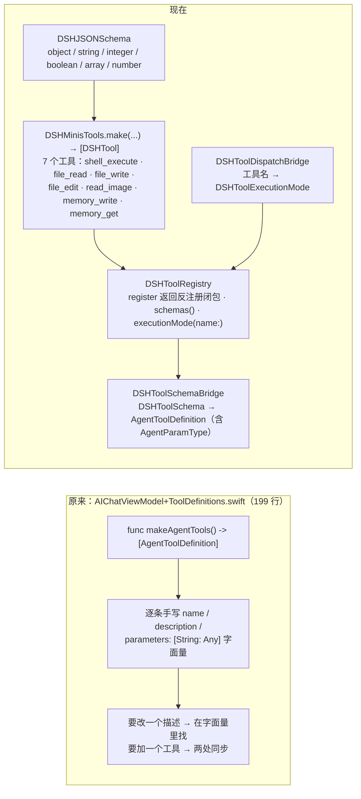

一点关键：**工具实现一行没改，而且不再被重新实现一遍。** 每个 `DSHTool` 的 body 直接调用 `executeSingleToolUse`——那是 Minis 完整的单次调用实现：流式输出写进块、图片预算、超长输出截断与 offload、loop detector、参数预检、工具快照。DSH 决定"什么时候跑"和"结果按什么顺序落盘"，不决定"这次调用做什么"。

### 工具面一致性

把调度换掉、把工具实现留下，就意味着**任何一处清单或参数的分歧，都是模型手里凭空少掉的能力**，而且不报错。这里踩过两次同一类坑，两次都是"抄了一份"：

| 坑 | 现象 | 现在的做法 |
|---|---|---|
| 抄了一份 schema | `dshAgentRegistry()` 和 `dshAgentTools()` 各手写一遍工具声明，两份都漏了 `browser_use` 和 iOS 26 线的 `subagent_task`——模型从未见过它们 | 名册来自 `makeAgentTools()`，`DSHMinisTools` 只负责把定义桥接成 `DSHTool`。**结构上不可能再漂移** |
| 抄了一份 handler | 适配器只挑自己认识的参数字段转发，`offset`/`lines`/`direction`/`max_length`/`create_dirs`/`delay` 全被吞掉，`read_image` 只回一句"图片 12 KB" | 执行走 `executeSingleToolUse`，参数整份转发 |

门控也只有一处：`makeAgentTools()` 是唯一知道内存开关、设置项开关、Vision Group、子代理开关的地方。

| 工具 | 门控 |
|---|---|
| `shell_execute` / `file_read` / `file_write` / `file_edit` | 总是注册 |
| `read_image` | `activeModelHasNativeVision \|\| VisionGroupResolver.isConfigured`（`[T-ios-vision-group #182]`） |
| `memory_write` / `memory_get` | `memoryEnabled` |
| `browser_use` | `Self.toolEnabled(.browser)` |
| `subagent_task`（仅 iOS 26 线） | `!isHelper && Self.toolEnabled(.agents)` |

`isConfigured` 必须在 `||` **之前**求值：短路会跳过这次读取，而这次读取正是维持 `isConfiguredCached` 镜像新鲜的来源（离屏占位构造依赖它）。

**工具结果不只是文本。** `read_image` 给模型的是图片，`browser_use` 给的是页面截图加落地 URL。这些字节挂在 **tool_result 这个 part 自己身上**（和原实现一致），不是单独一条消息——所以 `DSHToolResultBlock` 与 `DSHToolExecutionResult` 都带 `imageData` / `imageMimeType` / `pageURL` / `imageLinuxPath`，驱动在提交时写进去，投影时读出来。

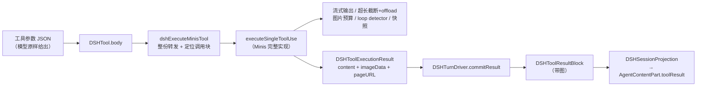

### 同一轮补齐的另外八个缺陷

这八个都是"验证 agent 全部能力"时才暴露出来的，不是顺手看到的：

**① 完全没有持久化。** `src/ios/DSH/` 里没有任何 `persistAgentMessage` 调用。DSH 模式下助手回复和工具结果**从不写进数据库**——屏幕上好好的，下次启动就没了，因为转录是从数据库重建的。现在每轮结束把本轮追加的条目写库（带本轮工具快照），并把数据库 id 回填到行上。

**② 工具结果被投影成 assistant 消息。** Minis 原 loop 把工具结果放在 **user** 消息里（`AgentMessage(role: .user, parts: toolResultParts)`），Anthropic 也要求 `tool_result` 不能出现在 assistant 轮里。原来的投影是 `role == .user ? .user : .assistant`，`.tool` 落进了 assistant——只因为 OpenAI 兼容路径宽容才没炸。

**③ loop guard 拿到的是空参数。** `gate.check(arguments: [:])` 意味着**同名工具的每次调用哈希都一样**：一轮里第 20 次 `file_read` 会被判成"重复调用"，它真实的返回被丢弃、换成一句拒绝。而且它在派发**之后**跑，本来就拦不住任何东西。现在按真实参数哈希、在调度前判定，被拒的调用也会先宣告一次，让它以工具自己的 block 头渲染。

**④ `propertyOrdering` 在 JSON Schema 往返里丢了。** 会用到它的 provider（Gemini）因此失去参数声明顺序。

**⑤ `willRunTool` 是死线。** `DSHToolScheduler.runCall` **从不调用**它——委托里有这个方法，但没有任何地方触发。也就是说工具块一直是 `dshRenderToolResult` 在结果落地时兜底建的 `.info` 块，从来没有工具自己的表头。改成由驱动在派发**之前**统一宣告每个调用（也让被 guard 拒绝的调用有个像样的块）。这个缺陷原来不可见，直到执行器开始按 call id 找块，它立刻变成每个工具都报 `no transcript block for call_...`，模型只好无限重试（设备上跑到 89 次）。

**⑥ 思考块从不渲染。** `didEmitReasoning` 只往 `dshPendingReasoning` 里累加，没有任何地方读它。现在按原实现的形状做：每段连续推理自成一个 `.thinking` 块、按到达顺序交错、用自适应节流刷到 `content`，收尾时强制冲刷尾部。

**⑦ 朗读（TTS）从不触发。** 原 loop 是**边流边读**——每凑齐一个完整句子就交给动态窗口合成。DSH 驱动自己消费流，于是 `extractNewSentences` / `feedDynamicTTS` / `stopSpeechForThisSession` 一次都没被调用，开着"朗读回复"也没有声音。现在在 `didEmitText` 里接回同一条路径（`speakEnabled` 实时读取而非回合开始快照，本会话上一轮朗读只在真的有新文本时才被打断），收尾时 `force: true` 冲刷尾部。

**⑧ 思考等级被写死 `.off`。** `buildRequest()` 里 `thinkingLevel: .off` 是个字面量。原 loop 从会话的 inference config 取值并夹到模型允许的上限，DSH 驱动两件都没做——于是**每个 DSH 回合都关着思考**，包括那些全部意义就在推理的模型，而且毫无痕迹。现在是配置字段，由调用方按原路径的同一套规则求值。

### 后来又抓出的三个，同一个病

**⑨ 记忆正文从不注入。** 提示词里有一句权威状态行：

> Memory status: ENABLED for this session. **GLOBAL.md and recent daily logs have been injected above (if non-empty)** …

原实现在构造请求时注入**三段**（`loadGlobalMemoryFragment()` + `loadRecentDailyMemoryFragment()` + 这句状态行），都在 `memoryEnabled` 门下。DSH 路径只注册了状态行——于是**那句话在说谎**（正是它自己 Honesty 段禁止的那种），而且模型拿不到任何记忆内容、只有工具。验证方式只有一种能做数：**要求模型不调用任何工具复述出记忆正文**。

**⑩ 会话标题从不生成。** `generateSessionTitleIfNeeded` 的**唯一调用点**在 `runAgentLoopCore` 里，紧跟第一次流式完成之后。DSH 回合从不调用它 → 列表里**每一行都叫「New Chat」**。修法：`willRunTool` 里收集本回合的 `(name, args)`，回合末交给同一个入口；要带工具条目是因为早期回合可能只有工具调用，纯工具的首个回复会被摘要成空串。

**⑪ 发送前闸门跑原版压缩。** `send()` 对 `.needsCompact` 的处置是原版 `compactAndSend()`——会在 DSH 即将重写的表面上再写一个 marker、再做一次摘要。DSH 回合本来就在构造请求前自查自压，闸门在这里无事可做，现在只记日志并继续发送。`.exhausted` 的提示保留：那是"整个请求都装不下"，驱动无法自愈。

### 这条模式值得单独记一笔

⑤⑥⑦⑧ 加上 ⑨⑩⑪，再加上"回合不落库"和"提示词片段丢失"——**都是同一种病**：

> **原循环做的事，DSH 回合没做。**

移植换掉了 loop 本身，但 view model 留着：消息列表、持久化、TTS、后台任务、标题生成、设置、闸门……凡是原循环在"跑一轮/收尾"时调用一次的东西，DSH 路径都必须也调用一次。**漏掉的不会报错**——列表静默地没有标题、提示词静默地少一段、库里静默地少一行。

而且这八条**没有一条是读代码读出来的**，全是真机验证时撞出来的。这就是为什么"验证 harness 够不够用"和修缺陷同等重要：harness 不够用，这类缺陷就永远不可见。

### 验证脚本本身也要被验证

这一轮的教训：第一版验证驱动**自己就是错的**，而它错的方式让"看起来很忙"和"什么都没测到"长得一模一样。

它每次采样都调用 `Get-BatchTailRows`，而那个 helper 内部会调 `Clear-BatchConversationView`——**6 次 swipe**。于是设备每 20 秒可视地滚一次，用户看到的就是"一直在下滑"。同时它测的东西也是错的：

- 签名取自**最后 4 行**，但这个 app 把一整轮合并成**一个**消息、工具块还是横向分页器（`‹ 3/3 ›`），所以尾部 4 行是分页器外壳，几乎立刻就不变了；
- 它还要求提示词前 12 个字符出现在那 4 行里。提示词一旦滚出可视区，这个条件**永远不可能成立**，于是循环必然跑满 900 秒超时。

重写后的驱动：采样只读 `get_ui_elements`，**回合期间一次都不碰屏幕**（列表停在贴底处就会一直自动跟随），签名取整流可视文本，并把**每次采样的文本都留下**再做并集断言——中途滚出视野的行也是证据。

结论：断言必须能区分"没通过"和"没测到"，否则验证会给出虚假的安心。


### 分页修复的真机验证

`file_read` 的参数转发在 iPhone 13 / iOS 15.3.1 上实测过。一轮里让模型自己生成文件、再按范围读回：

| 步骤 | 工具块实际输出 |
|---|---|
| `shell_execute` 生成 200 行文件 | `/root/paging.txt` → 1692 bytes / 201 lines |
| `file_read`，`offset=100` + `lines=6` | `showing lines **100-105** of 201` |
| `file_read`，`direction=tail` + `lines=3` | `showing lines **199-201** of 201` |

修复前这两次读取都会返回 `showing lines 1-N of 201`——参数被适配器吞掉，schema 却还在对模型宣称可用。模型随后正确指出文件末尾多了一个空行，说明它读到的是真实的文件内容而不是记忆里的猜测。

证据：`shots/dsh-fix-02-paging.jpg`。


---

## 8. 文件清单与职责

### 新增（`src/ios/DSH/`，20 个 Swift 文件 + README）

| 文件 | 对应 DSH 源码 | 职责 |
|---|---|---|
| `DSHTypes.swift` | `packages/llm/llm/src/types.ts` | provider 中立词表：block / message / finish / failure / usage / schema / stream chunk |
| `DSHSystemPrompt.swift` | `packages/core/system-prompt/src/index.ts` | 有序 section 注册表、严格插值、装配与渲染 |
| `DSHToolRegistry.swift` | `packages/core/tools/src/index.ts` | 工具注册表、执行模式、参数解析、取消令牌 |
| `DSHToolScheduler.swift` | `packages/core/agent-loop/src/tool-calls.ts` | 声明式并发调度、连续槽提交 |
| `DSHToolGate.swift` | repeat-tool reminder + scheduler guards | 派发前守卫：重复 / 无进展 |
| `DSHSession.swift` | `packages/session` | append-only 日志、`DSHSeq`、shadow 表面、tool-pairing 平衡 |
| `DSHCompaction.swift` | `packages/compaction/compaction-basic/src/region.ts` | 选择规则、摘要落地、缩减比 |
| `DSHTurnDriver.swift` | `packages/core/agent-loop/src/agent.ts` | turn 循环、请求推导、结果落盘顺序 |
| `DSHJSONSchema.swift` | `packages/core/tools/src/json-schema.ts` | 类型化 JSON Schema 构造器 |
| `DSHToolSchemaBridge.swift` | — | `DSHToolSchema` → `AgentToolDefinition` |
| `DSHToolDispatchBridge.swift` | — | 工具名 → 并发模式（Minis 策略） |
| `DSHToolBlockKind.swift` | — | 工具名 + 参数 → `AssistantBlockKind` |
| `DSHMinisPrompt.swift` | — | Minis 专属提示词段 + 运行时上下文段 |
| `DSHMinisTools.swift` | — | Minis 工具定义 → `DSHTool`（schema 桥接，含 `propertyOrdering`） |
| `DSHPromptAdapter.swift` | — | 提示词入口 + `dshAgentTools()`（= `makeAgentTools()`）+ `useDSHAgentLoop` 开关 |
| `DSHTurnDriverRun.swift` | — | `runDSHTurn()`、阈值推导、session 同步、**持久化**、文本节流 |
| `DSHTurnDriverAdapter.swift` | — | `DSHTurnDriverDelegate` 实现、调用块创建、工具结果渲染、分隔行 |
| `DSHTurnDriverBridge.swift` | — | `DSHSessionProjection`（双向，含 role 映射）+ `DSHToolHandler` |
| `DSHToolHandlers.swift` | — | 按 `makeAgentTools()` 名册组装 `[DSHTool]` |
| `DSHToolHandlerImpl.swift` | — | 单次调用 → `executeSingleToolUse`（Minis 完整实现） |

### 修改（3 个源文件 + 工程文件）

| 文件 | 改动 |
|---|---|
| `src/ios/Agent/Chat/AIChatViewModel.swift` | +DSH 状态块（10 个属性）；3 个 `runAgentLoop()` 调用点分支；2 处 `private func` → `func`；工具集与提示词各 2 处改为条件取值 |
| `src/ios/Agent/Chat/ChatModels.swift` | `ChatMessage.dshSeq: Int?` |
| `src/ios/Providers/AgentProvider.swift` | `AgentMessage.dshSeq: Int?` |
| `src/ios/Minis.xcodeproj/project.pbxproj` | 新增 `PBXFileSystemSynchronizedRootGroup`，挂到 Minis target 的 `fileSystemSynchronizedGroups` |
| `.github/workflows/build-ipa.yml` | 双线构建（ios15 / ios26）+ 自动 Release + 构建前校验模块接入 |

### 未被改写（刻意）

`AIChatViewModel+Compaction.swift`（1084 行）、`+Persistence.swift`（1827 行）、`+ConcurrentTools.swift`、`+ToolDefinitions.swift`、`+SSEStream.swift`、`ContextPolicy.swift` 全部原样保留——当 `useDSHAgentLoop == false` 时它们仍然是对的路径，这就是 A/B 对比的基础。DSH 侧是**调用**它们，不是复制它们。

---

## 9. 开关与回退

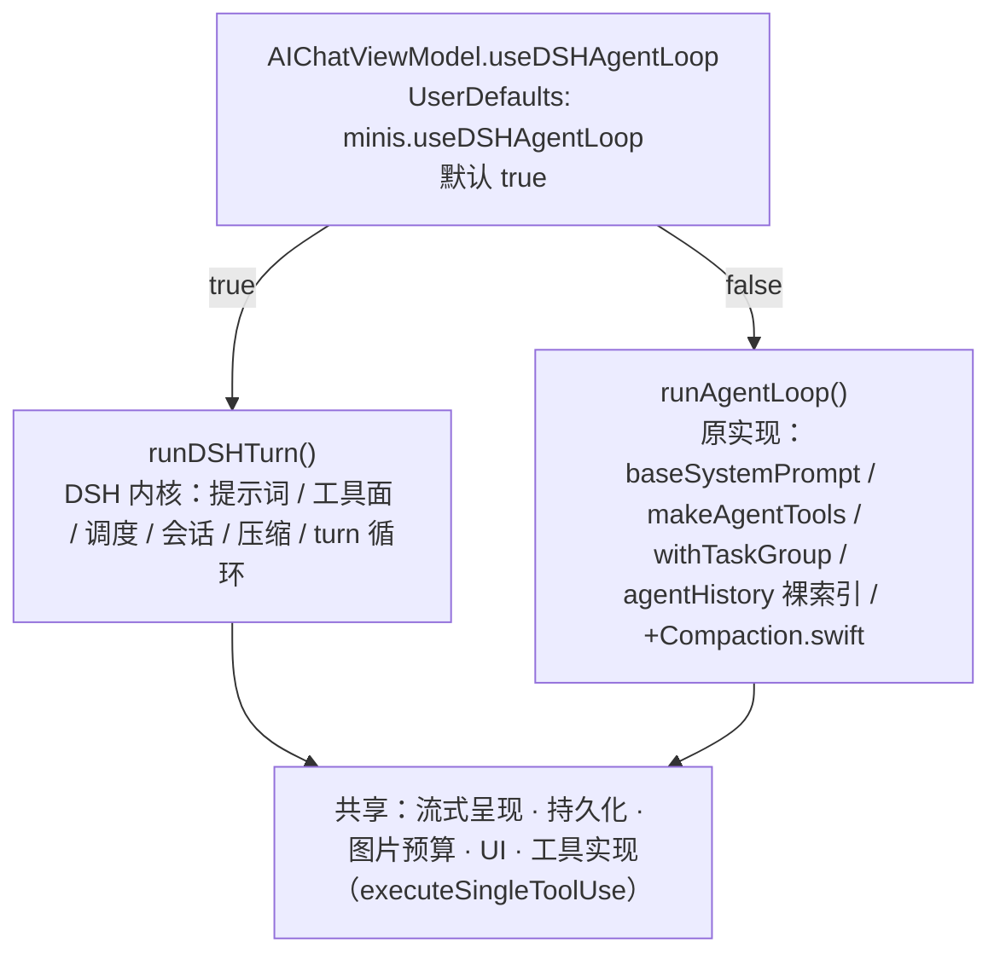

- 开关是**类级静态属性**，不在会话或消息粒度上；同一进程内一致。
- 两个分支共用同一套持久化、UI 与工具实现，所以切换不会产生两套数据，也不会产生两种工具行为。
- 测试用阈值是**编译期**的（`dshCompactionProbeEnabled`），出厂值 `false`。原因是外部写 `UserDefaults` 无效：App 启动时注册自己的 defaults 字典并整份重写 plist，外部写入的 key 会被丢掉。

---

## 10. 移植到不同源码线的成本

实测结论：**21 个模块文件里只有 2 个必须逐行不同**，其余 19 个字节一致。

| 文件 | 为什么不同 |
|---|---|
| `DSHTurnDriver.swift` | v1.14 给 `AgentStreamEvent` 加了 `.responseModel`，switch 必须穷尽；`AgentContentPart` 的构造点虽然带标签可省，模式匹配不行 |
| `DSHTurnDriverBridge.swift` | 唯一对 `AgentContentPart` 做**模式匹配**的地方（`.toolUse` 3→4 元、`.toolResult` 8→9 元），外加 `lineSpecificKind` —— iOS 26 线的 `AssistantBlockKind` 有 `delegateTool(title:)`，iOS 15 线没有 |

把这两件事都限制在一个文件里是有意的：**分支差异只允许出现在"接触 Minis 类型"的那一层**，内核其余部分改一次、验一次即可。

其余需要按上下文重贴的部分：

| 项 | 说明 |
|---|---|
| 3 个 `runAgentLoop()` 调用点 | 上游行号不同，按局部上下文重新定位 |
| `dshSeq` 两个字段 | 各一行 |
| pbxproj 同步组 | 3 处编辑；父组必须无 `path =`，否则 `path = DSH` 解析到错目录，报 `cannot find dshSystemPrompt in scope` |
| DSH 状态块 | `AIChatViewModel` 里 10 个属性 |
| workflow | 一条即可——ios26 job 固定 checkout `ios26` 分支，helper 从 `origin/main` 取 |

这就是同一份内核对两条线能用同一套流程、且修一次两边都好的原因。

---

## 8. 已知缺口（审计结论）

用同一套办法——"原循环做的事，DSH 回合做了吗"——把整条 `runAgentLoop` 逐调用核对了一遍。已修的见 §7。**下面这些是没修的**，写清楚后果，不粉饰。

### 已修（本轮）

| 缺口 | 后果 | 修法 |
|---|---|---|
| 会话 token 累计 + 行上 `usage` | 会话用量面板整个 DSH 会话都显示 0/—（输入、输出、缓存读写、命中率、输出速度），行级读数也空着——要重启一次才由数据库补上 | 在 `didReportUsage` 累计、在回合收口时盖到行上，都与原循环同一位置 |
| `maxTokens` 绕过 `dynamicMaxTokens` | 用户在单个模型上设的「最大输出」被忽略；请求也不再按**剩余窗口**夹住——上下文接近满时会要一个装不下的输出量 | 走原循环同一个 `dynamicMaxTokens(provider:model:lastContextTokens:)` |
| 增强缓存开关无效 | `RequestBodyPatcher.setExtendedCacheTTL` 只在原循环开头设置，DSH-only 会话里标志一直是 false，用户那个开关**静默无效** | 回合开头设置 |
| 停止变成报错 | 取消会拆掉 provider 流，怎么表现出来取决于 provider——可能以流错误到达；`didFail` 无条件报错，于是**用户按「停止」得到一条错误横幅** | `didFail` 先看 `userDidCancel`，走取消清理（与原循环 catch 同规则） |
| 瞬态流错误不重试 | `streamWithAutoRetry` 只在原循环里。一次 5xx/网络抖动，或紧跟工具结果后的空回复，现在直接以错误横幅结束回合，而原来会静默恢复 | 驱动侧加退避重试：策略以**数据 + 委托回调**传入（`streamRetryDelays` + 两个回调），不用闭包——config 是 `Sendable`，`@Sendable` 闭包回调进 main-actor view model 每次都要重新隔离。判据沿用 `LLMError.isRetryable`，倒计时接回原版 banner 读的同一对状态；退避期间取消按 `.cancelled` 收尾，Stop 仍然有效 |

### 未修

| 缺口 | 后果 | 为什么先不做 |
|---|---|---|
| **group fallback** | 主成员限流/故障时直接失败报错，而不是静默换备。**文档曾错写成"仍保留"**——已在 §7 与 `DSH/README.md` 更正 | 需要第二个 provider 才能实测；不测就上一个改了主流程的功能不可取 |
| 空回复提醒（重试的另一半） | 原循环在"紧跟工具结果却回了空内容"时，会往最后一条工具结果里注入 `<system-reminder>` 再跑一轮。**重试本身已修**（见上表），这一半没做——那种情况下模型仍会以空回复结束回合 | 需要在会话里做注入，且不好稳定复现，留待有把握时再动 |
| 旧图片不驱逐 | `trimOldImagesFromHistory()` 只在原循环每次迭代调用，DSH 表面上的历史图片会一直重发。**但影响有上限**：DSH 压缩在窗口 80% 时会连图片一起摘掉 | 会话是 append-only，真要驱逐得走压缩式的重写；现有压缩已经兜住"无界增长"这一半 |
| 后台授权到期不挂起 | `waitIfBackgroundSuspended()` 只在原循环里，后台跑长回合可能在授权过期后继续发请求被杀 | 设备实测 DSH 回合能跨前后台完成（§T3-07），先记录 |
| 浏览器接管不挂起 | 工具级的 `waitForMidActionTakeover` 仍在（`executeSingleToolUse` 内），但它在**动作已经执行之后**才生效；步骤之间开始的接管不会被拦住 | 同上 |
| 缓存保活不调度 | `CacheKeepAliveManager.recordRequest` 只在原循环里，Anthropic 的 prompt cache 在间隔较久的回合之间会冷掉 → 计费更高、首 token 更慢 | 影响成本而非正确性 |
| 图片被换成占位符时不提示模型 | 同一个 `BatchImageBudget` 还在，但原循环会追一句 `<system-reminder>` 告诉模型"图被换成文字了，请总结后重读"，DSH 不发 | 同上 |
| Live Activity 的 Loop 计数 | 整个 DSH 回合停在 "Loop 0" | 本机 iOS 15.3.1 无 ActivityKit，测不了 |
| 排队提示不打断当前回合 | 原循环在工具调用一闭合就把排队消息插成独立回合；DSH 只在整个回合结束后才 drain → 长回合里排队的消息要等完 | 可能是设计选择；T2-18 已验证"回合末作为独立回合应答"是通的 |
| 崩溃上报不带 provider/model | `CrashReporter.setLastAPI` 只在原循环里 | 纯诊断 |

### 这份审计本身的价值

它把"读代码"变成了这个项目里最有效率的一次缺陷发现：**17 项里 4 项当场修掉、1 项是文档说谎、其余 12 项第一次被写清楚**。而且它给出的"检查过、已覆盖"清单同样重要——那些地方我不用再怀疑。

