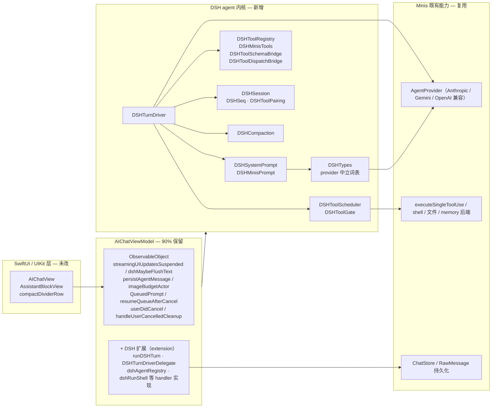
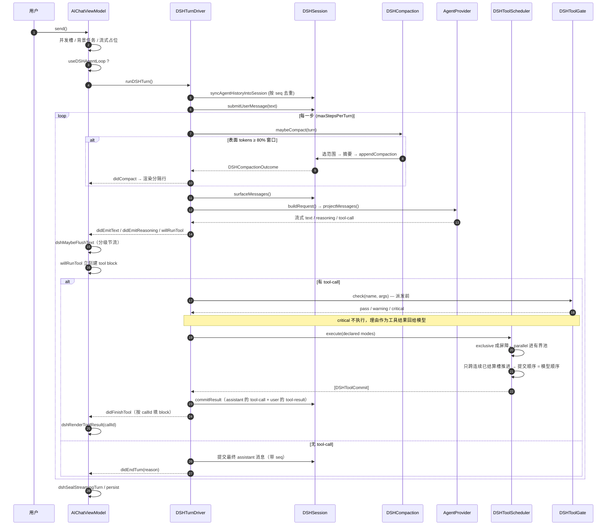
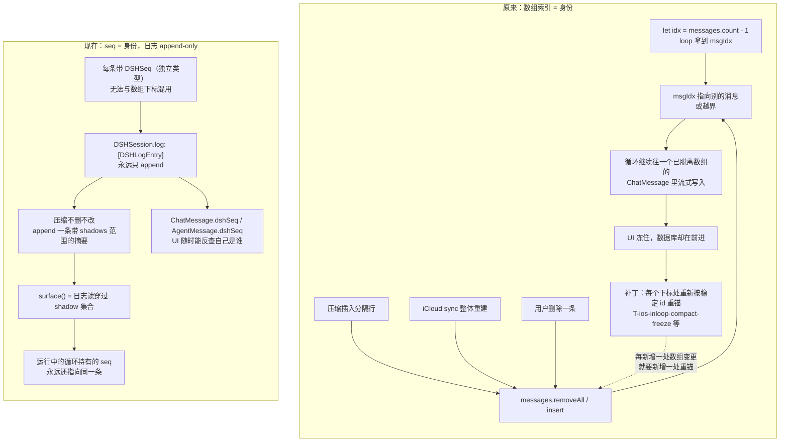
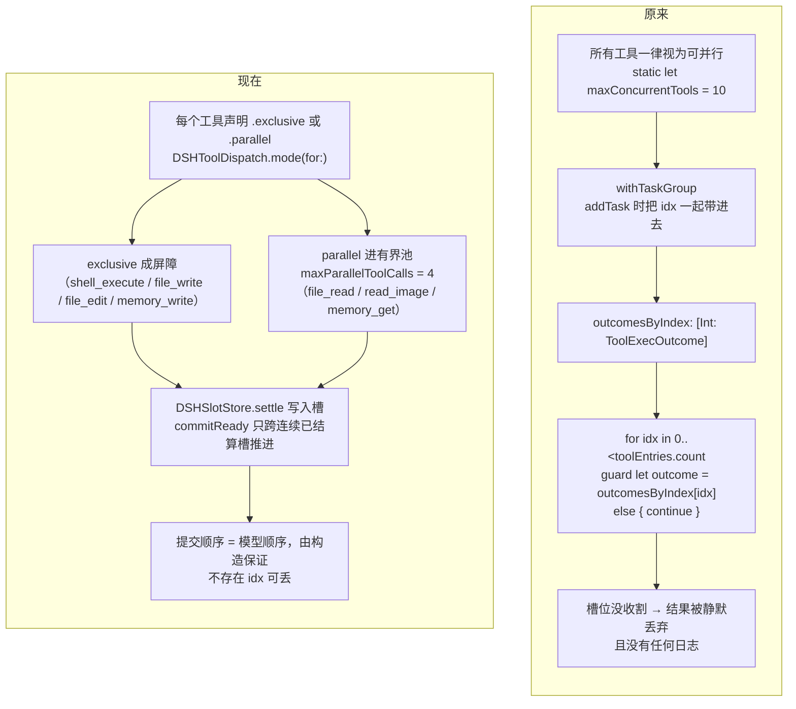
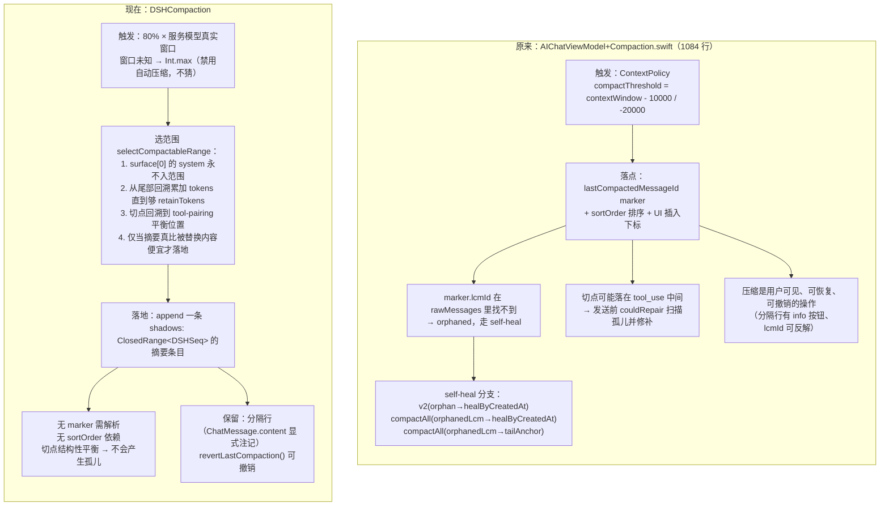
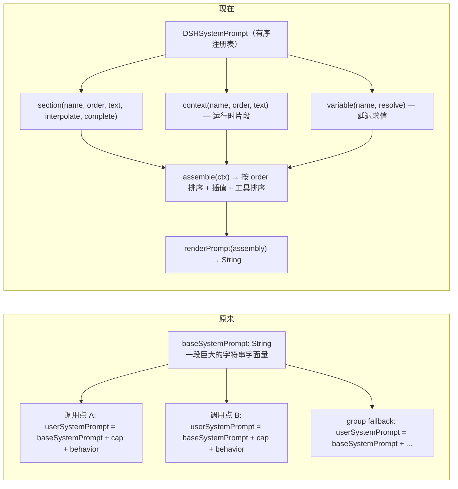
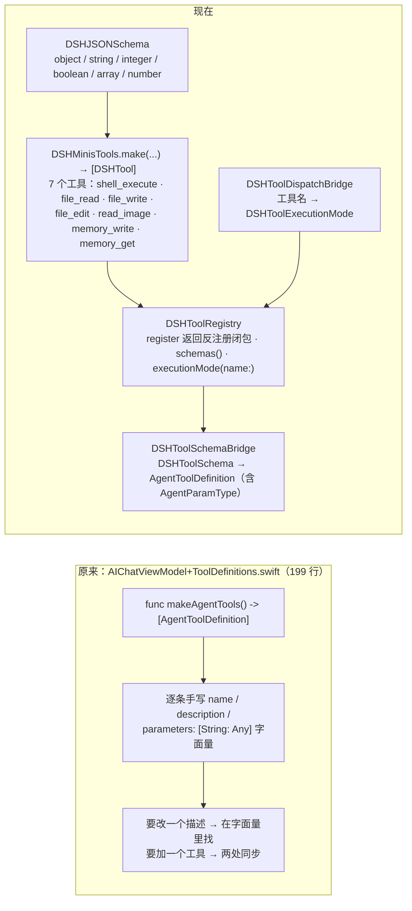
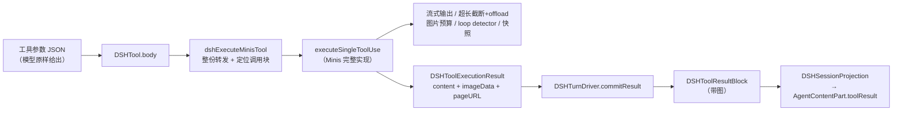
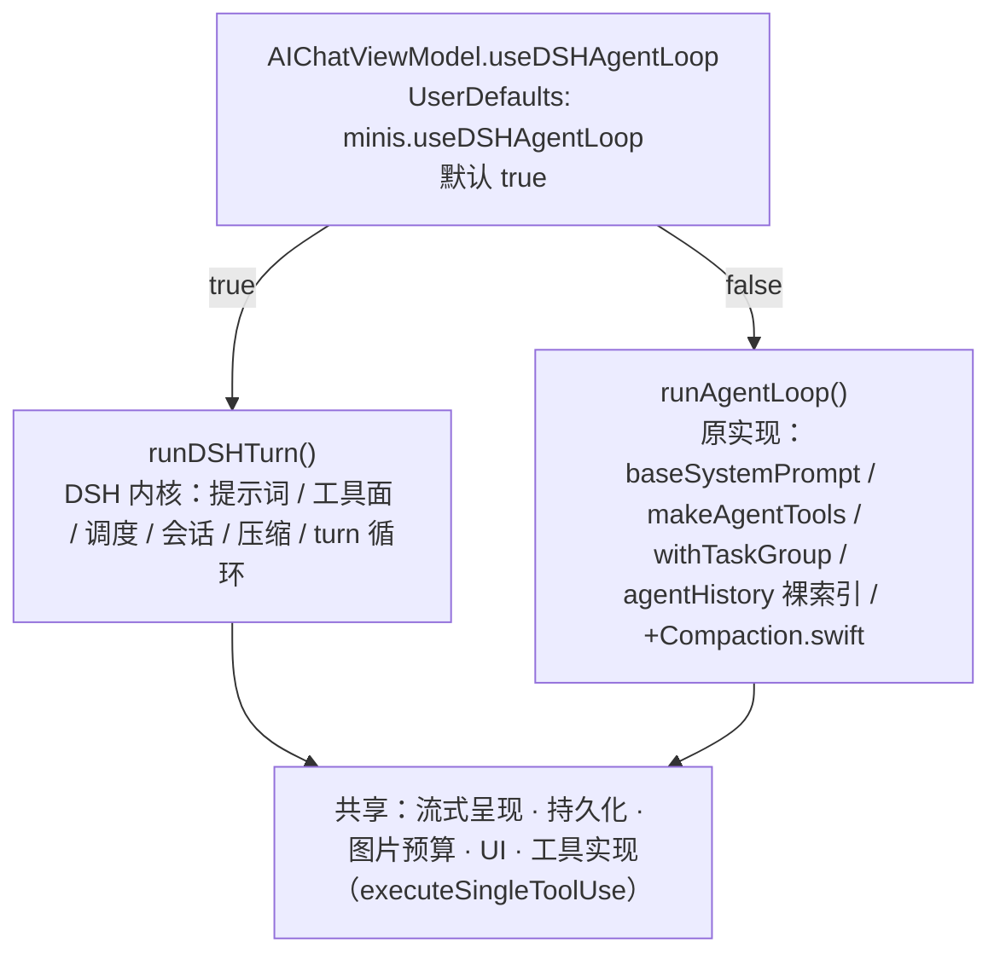

# OpenMinis × DSH agent 内核 — 架构与前后差别

本文回答三件事：**原来长什么样**、**现在长什么样**、**每一处差异的根因是什么**。

所有"原来"的引用都指向 `zhaoxiufei/OpenMinis` main（iOS 15 基线，本地 `upstream/main`）；
"现在"指向本文档所在仓库的 HEAD。

---

## 0. 一页对照

**替换的五个"决策段"**：系统提示词装配、工具注册与 schema、工具调度、会话身份、压缩。
**保留的一切**：流式渲染、持久化、图片预算、group fallback、TTS、队列、取消清理、全部 UI，以及**每个工具的实际实现**（handler 原地复用）。

---

## 1. 分层结构

关键边界：**DSH 内核不认识 `AIChatViewModel`，也不认识 `ChatMessage`。**
它只认识 `DSHMessage` / `DSHContentBlock` / `DSHToolExecutionResult`，进出都靠两个 Bridge 翻译。
这条边界就是"能同时移植到 iOS 15 与 iOS 26 两条源码线"的原因——内核与 Minis 的耦合只集中在 4 个 Bridge 文件里。

---

## 2. 一轮 turn 的时序

### 原时序的差别

| 环节 | 原来 | 现在 |
|---|---|---|
| 每轮起点 | `try Task.checkCancellation()` 后**重新按稳定 id 重锚 `msgIdx`**（`[T-ios-inloop-compact-freeze]`） | 不需要。seq 是不变量，不存在"重锚"这个动作 |
| 上下文检查 | 只在 `send()` 入口的 `checkContextBeforeSend()` + 循环内每轮重新评估 `ContextPolicy`（`.needsCompact` / `.exhausted`），压缩计数上限 `maxInLoopCompactions = 3` | `DSHTurnDriver.maybeCompact()` 一步，阈值 = 服务模型真实窗口的 80% |
| 工具结果回填 | `withTaskGroup` + `outcomesByIndex: [Int: ToolExecOutcome]`，之后 `guard let outcome = outcomesByIndex[idx] else { continue }` | `DSHSlotStore` + `commitReady()` 只跨连续槽推进，无索引可丢 |
| 工具 UI block | 结果挂在 `pendingSnapshots` / `toolStatusStrings`，靠二次遍历 `messages[msgIdx].blocks` 匹配 `toolUseId` | `willRunTool` 就建 block，`didFinishTool` 按 `callId` 填，别的路径抢不走 |
| 提示词 | 每个调用点 `baseSystemPrompt` 各拼一遍 + `capabilityPromptFragment` + `agentBehaviorPromptFragment` | `dshSystemPrompt` 有序 section 装配，运行时片段走 `context()` |

---

## 3. 会话身份：裸 Int 索引 → DSHSeq + shadow

这是整次移植里**唯一一个"删掉一整类 bug"**的改动，也是理解那 91 处补丁的钥匙。

### 为什么会有那 91 处补丁

`AIChatViewModel` 用**裸 `Int` 下标**寻址可变数组里的对话条目，而所有东西都能在 loop 运行期间改变这个数组：
压缩插入分隔行、iCloud 同步整体 `reloadMessagesFromDB`、用户删除、状态行 `removeAll`。

每一次变更都会让 loop 手里那个 `Int` 失效。失效的表现**不是崩溃而是静默**：loop 还在往一个已经不在数组里的 `ChatMessage` 写内容，屏幕不动，但数据库在前进。于是每个能被观察到的下标使用点都长出了一处"按稳定 id 重锚"的补丁。每一处单看都正确；合起来的意思是——**任何一处新增的数组变更，都要配套新增 N 处重锚**。

`DSHSession` 消掉的是这个类，而不是这些实例：

| 手段 | 效果 |
|---|---|
| 日志只 append，条目永不移动/替换/删除 | 没有"失效"这个状态 |
| `DSHSeq` 是独立类型（不是 `Int` 别名） | 编译期阻止把 seq 当下标用 |
| 压缩用追加的摘要**遮蔽**一段 seq 范围 | 运行中的 loop 持有的 seq 仍然有效 |
| `surface()` 是"日志穿过当前 shadow 集合"的派生视图 | 表面会变，日志不变 |
| `DSHToolPairing.cutBalances` / `nearestBalancedBefore` | 切点保证 tool call 与 result 不分离 |

最后一条对应原来的 `[T-ios-compact-orphan-toolcall]`：原来用**发送前扫描孤儿 tool part 再修补**（`AIChatViewModel+Persistence.swift:1506` 起）来兜底，现在是**切点根本不允许切在那里**。

---

## 4. 工具调度：cap + 索引缝合 → 声明式并发 + 连续提交

三点实质差别：

1. **并发是数据，不是假设。** 原来"所有工具都可并行 + 一个 in-flight 上限"，等于假设工具之间没有共享状态。实际上 `shell_execute` / `file_write` / `file_edit` 都在动同一个沙箱。现在它们标 `.exclusive`，重叠执行从"靠运气"变成"不可能"。未知工具**默认 exclusive**——想并行必须显式声明，而不是默认继承。
2. **顺序由构造保证，而不是靠事后缝合。** 原来结果按 `idx` 存在字典里再按 `0..<count` 遍历回填，缺一个就 `continue` 掉。现在提交器只跨**连续已结算**的槽前进，模型顺序天然成立，且没有中间容器可以丢东西。
3. **守门在派发之前。** `DSHToolGate.check()` 在工具真正执行前跑：重复的无进展调用**不会执行**，理由是作为工具结果回给模型（`warning` / `critical` 两级 + 稳定 hash 归一化参数），而不是执行完再抱怨。

---

## 5. 压缩：marker / anchor / sortOrder → selectCompactableRange

### 阈值语义的差别（重要）

| | 原来 | 现在 |
|---|---|---|
| 触发点 | `窗口 - 10000`（大窗口）/ `窗口 - 20000` | `窗口 × 80%`（262144 → **209715**） |
| 窗口未知时 | 按 `ContextPolicy` 的默认分支 | **`Int.max` = 不自动压缩** |
| 循环内次数上限 | `maxInLoopCompactions = 3`，超过则"exhausted"停机 | 无人工上限；由"摘要必须真的更便宜"+"切点必须平衡"自然收敛 |
| 保留尾部 | 无显式预算，靠 marker 位置 | `retainTokens = 20000` |
| 落地条件 | 压缩成功即落地 | 摘要更便宜才落地，否则**拒绝** |

"窗口未知就不压缩"是一个刻意的选择：**把用户当前的请求压缩掉，比跑长一点更糟。**

### 实测数据（真机 iPhone 13 / iOS 15.3.1）

| | 压缩前 | 压缩后 |
|---|---|---|
| surface 条目 | 18 | **9** |
| 估算 tokens | 2026 | **1330** |
| 缩减 | — | **34%** |

同一轮里的 `shell_execute` 照常完成，压缩后模型仍能从摘要正确作答。算法另用 Python 等价实现（`_testdata/compaction_probe.py`）跑过合成表面：

| 场景 | 结果 |
|---|---|
| 20 × 20k 字符长工具输出 | 缩小 94%，切点平衡 |
| 图片块 | 缩小 73%，切点平衡 |
| 刚过阈值 | 缩小 45%，切点平衡 |
| retain 预算 > 整个表面 | 正确拒绝 |
| 会话太小 / 无 system 头 | 正确拒绝 |

---

## 6. 系统提示词：字符串拼接 → 有序 section 注册表

- `{{variable}}` 是**严格**插值：`DSHSystemPrompt.interpolate` 按 UTF-16 code unit 扫描（`nextCloseBrace`），不认识的变量不会被静默吃掉。
- 三段内容分包：**基础内核段** `dshSystemPrompt`、**Minis 专属段** `DSHMinisPrompt.registerBase(into:)`（返回反注册闭包）、**运行时上下文** `DSHMinisPrompt.runtimeContextSection`（模型名 / provider / cwd / 工具名 / isHelper）。
- 反注册闭包让提示词是**资源而非全局状态**：注册即得 undo，作用域结束即干净。

---

## 7. 工具注册：手写字面量 → 注册表 + 类型化 schema

一点关键：**工具实现一行没改，而且不再被重新实现一遍。** 每个 `DSHTool` 的 body 直接调用 `executeSingleToolUse`——那是 Minis 完整的单次调用实现：流式输出写进块、图片预算、超长输出截断与 offload、loop detector、参数预检、工具快照。DSH 决定"什么时候跑"和"结果按什么顺序落盘"，不决定"这次调用做什么"。

### 工具面一致性

把调度换掉、把工具实现留下，就意味着**任何一处清单或参数的分歧，都是模型手里凭空少掉的能力**，而且不报错。这里踩过两次同一类坑，两次都是"抄了一份"：

| 坑 | 现象 | 现在的做法 |
|---|---|---|
| 抄了一份 schema | `dshAgentRegistry()` 和 `dshAgentTools()` 各手写一遍工具声明，两份都漏了 `browser_use` 和 iOS 26 线的 `subagent_task`——模型从未见过它们 | 名册来自 `makeAgentTools()`，`DSHMinisTools` 只负责把定义桥接成 `DSHTool`。**结构上不可能再漂移** |
| 抄了一份 handler | 适配器只挑自己认识的参数字段转发，`offset`/`lines`/`direction`/`max_length`/`create_dirs`/`delay` 全被吞掉，`read_image` 只回一句"图片 12 KB" | 执行走 `executeSingleToolUse`，参数整份转发 |

门控也只有一处：`makeAgentTools()` 是唯一知道内存开关、设置项开关、Vision Group、子代理开关的地方。

| 工具 | 门控 |
|---|---|
| `shell_execute` / `file_read` / `file_write` / `file_edit` | 总是注册 |
| `read_image` | `activeModelHasNativeVision \|\| VisionGroupResolver.isConfigured`（`[T-ios-vision-group #182]`） |
| `memory_write` / `memory_get` | `memoryEnabled` |
| `browser_use` | `Self.toolEnabled(.browser)` |
| `subagent_task`（仅 iOS 26 线） | `!isHelper && Self.toolEnabled(.agents)` |

`isConfigured` 必须在 `||` **之前**求值：短路会跳过这次读取，而这次读取正是维持 `isConfiguredCached` 镜像新鲜的来源（离屏占位构造依赖它）。

**工具结果不只是文本。** `read_image` 给模型的是图片，`browser_use` 给的是页面截图加落地 URL。这些字节挂在 **tool_result 这个 part 自己身上**（和原实现一致），不是单独一条消息——所以 `DSHToolResultBlock` 与 `DSHToolExecutionResult` 都带 `imageData` / `imageMimeType` / `pageURL` / `imageLinuxPath`，驱动在提交时写进去，投影时读出来。

### 同一轮补齐的另外四个缺陷

这四个都是"验证 agent 全部能力"时才暴露出来的，不是顺手看到的：

**① 完全没有持久化。** `src/ios/DSH/` 里没有任何 `persistAgentMessage` 调用。DSH 模式下助手回复和工具结果**从不写进数据库**——屏幕上好好的，下次启动就没了，因为转录是从数据库重建的。现在每轮结束把本轮追加的条目写库（带本轮工具快照），并把数据库 id 回填到行上。

**② 工具结果被投影成 assistant 消息。** Minis 原 loop 把工具结果放在 **user** 消息里（`AgentMessage(role: .user, parts: toolResultParts)`），Anthropic 也要求 `tool_result` 不能出现在 assistant 轮里。原来的投影是 `role == .user ? .user : .assistant`，`.tool` 落进了 assistant——只因为 OpenAI 兼容路径宽容才没炸。

**③ loop guard 拿到的是空参数。** `gate.check(arguments: [:])` 意味着**同名工具的每次调用哈希都一样**：一轮里第 20 次 `file_read` 会被判成"重复调用"，它真实的返回被丢弃、换成一句拒绝。而且它在派发**之后**跑，本来就拦不住任何东西。现在按真实参数哈希、在调度前判定，被拒的调用也会先宣告一次，让它以工具自己的 block 头渲染。

**④ `propertyOrdering` 在 JSON Schema 往返里丢了。** 会用到它的 provider（Gemini）因此失去参数声明顺序。

### 分页修复的真机验证

`file_read` 的参数转发在 iPhone 13 / iOS 15.3.1 上实测过。一轮里让模型自己生成文件、再按范围读回：

| 步骤 | 工具块实际输出 |
|---|---|
| `shell_execute` 生成 200 行文件 | `/root/paging.txt` → 1692 bytes / 201 lines |
| `file_read`，`offset=100` + `lines=6` | `showing lines **100-105** of 201` |
| `file_read`，`direction=tail` + `lines=3` | `showing lines **199-201** of 201` |

修复前这两次读取都会返回 `showing lines 1-N of 201`——参数被适配器吞掉，schema 却还在对模型宣称可用。模型随后正确指出文件末尾多了一个空行，说明它读到的是真实的文件内容而不是记忆里的猜测。

证据：`shots/dsh-fix-02-paging.jpg`。

---

## 8. 文件清单与职责

### 新增（`src/ios/DSH/`，20 个 Swift 文件 + README）

| 文件 | 对应 DSH 源码 | 职责 |
|---|---|---|
| `DSHTypes.swift` | `packages/llm/llm/src/types.ts` | provider 中立词表：block / message / finish / failure / usage / schema / stream chunk |
| `DSHSystemPrompt.swift` | `packages/core/system-prompt/src/index.ts` | 有序 section 注册表、严格插值、装配与渲染 |
| `DSHToolRegistry.swift` | `packages/core/tools/src/index.ts` | 工具注册表、执行模式、参数解析、取消令牌 |
| `DSHToolScheduler.swift` | `packages/core/agent-loop/src/tool-calls.ts` | 声明式并发调度、连续槽提交 |
| `DSHToolGate.swift` | repeat-tool reminder + scheduler guards | 派发前守卫：重复 / 无进展 |
| `DSHSession.swift` | `packages/session` | append-only 日志、`DSHSeq`、shadow 表面、tool-pairing 平衡 |
| `DSHCompaction.swift` | `packages/compaction/compaction-basic/src/region.ts` | 选择规则、摘要落地、缩减比 |
| `DSHTurnDriver.swift` | `packages/core/agent-loop/src/agent.ts` | turn 循环、请求推导、结果落盘顺序 |
| `DSHJSONSchema.swift` | `packages/core/tools/src/json-schema.ts` | 类型化 JSON Schema 构造器 |
| `DSHToolSchemaBridge.swift` | — | `DSHToolSchema` → `AgentToolDefinition` |
| `DSHToolDispatchBridge.swift` | — | 工具名 → 并发模式（Minis 策略） |
| `DSHToolBlockKind.swift` | — | 工具名 + 参数 → `AssistantBlockKind` |
| `DSHMinisPrompt.swift` | — | Minis 专属提示词段 + 运行时上下文段 |
| `DSHMinisTools.swift` | — | Minis 工具定义 → `DSHTool`（schema 桥接，含 `propertyOrdering`） |
| `DSHPromptAdapter.swift` | — | 提示词入口 + `dshAgentTools()`（= `makeAgentTools()`）+ `useDSHAgentLoop` 开关 |
| `DSHTurnDriverRun.swift` | — | `runDSHTurn()`、阈值推导、session 同步、**持久化**、文本节流 |
| `DSHTurnDriverAdapter.swift` | — | `DSHTurnDriverDelegate` 实现、调用块创建、工具结果渲染、分隔行 |
| `DSHTurnDriverBridge.swift` | — | `DSHSessionProjection`（双向，含 role 映射）+ `DSHToolHandler` |
| `DSHToolHandlers.swift` | — | 按 `makeAgentTools()` 名册组装 `[DSHTool]` |
| `DSHToolHandlerImpl.swift` | — | 单次调用 → `executeSingleToolUse`（Minis 完整实现） |

### 修改（3 个源文件 + 工程文件）

| 文件 | 改动 |
|---|---|
| `src/ios/Agent/Chat/AIChatViewModel.swift` | +DSH 状态块（10 个属性）；3 个 `runAgentLoop()` 调用点分支；2 处 `private func` → `func`；工具集与提示词各 2 处改为条件取值 |
| `src/ios/Agent/Chat/ChatModels.swift` | `ChatMessage.dshSeq: Int?` |
| `src/ios/Providers/AgentProvider.swift` | `AgentMessage.dshSeq: Int?` |
| `src/ios/Minis.xcodeproj/project.pbxproj` | 新增 `PBXFileSystemSynchronizedRootGroup`，挂到 Minis target 的 `fileSystemSynchronizedGroups` |
| `.github/workflows/build-ipa.yml` | 双线构建（ios15 / ios26）+ 自动 Release + 构建前校验模块接入 |

### 未被改写（刻意）

`AIChatViewModel+Compaction.swift`（1084 行）、`+Persistence.swift`（1827 行）、`+ConcurrentTools.swift`、`+ToolDefinitions.swift`、`+SSEStream.swift`、`ContextPolicy.swift` 全部原样保留——当 `useDSHAgentLoop == false` 时它们仍然是对的路径，这就是 A/B 对比的基础。DSH 侧是**调用**它们，不是复制它们。

---

## 9. 开关与回退

- 开关是**类级静态属性**，不在会话或消息粒度上；同一进程内一致。
- 两个分支共用同一套持久化、UI 与工具实现，所以切换不会产生两套数据，也不会产生两种工具行为。
- 测试用阈值是**编译期**的（`dshCompactionProbeEnabled`），出厂值 `false`。原因是外部写 `UserDefaults` 无效：App 启动时注册自己的 defaults 字典并整份重写 plist，外部写入的 key 会被丢掉。

---

## 10. 移植到不同源码线的成本

| 层 | 需要改吗 | 说明 |
|---|---|---|
| `src/ios/DSH/` 20 个文件 | **原样复制** | 内核不认识 `AIChatViewModel`，只认识 DSH 词表 |
| 4 个 Bridge 文件 | 可能要适配 | 唯一接触 Minis 类型的地方（`AgentContentPart` 的 `toolResult` 关联值、`AssistantBlockKind` 的 case、`LLMUsage` 字段） |
| 3 个调用点 | 按上下文重贴 | 上游源码行号不同，要按局部上下文重新定位 |
| `dshSeq` 两个字段 | 各一行 | |
| pbxproj 分组 | 3 处编辑 | 父组必须无 `path =`，否则 `path = DSH` 解析到错目录，报 `cannot find dshSystemPrompt in scope` |

这就是为什么同一份内核对 iOS 15 线与 iOS 26 线能用同一套移植流程。
